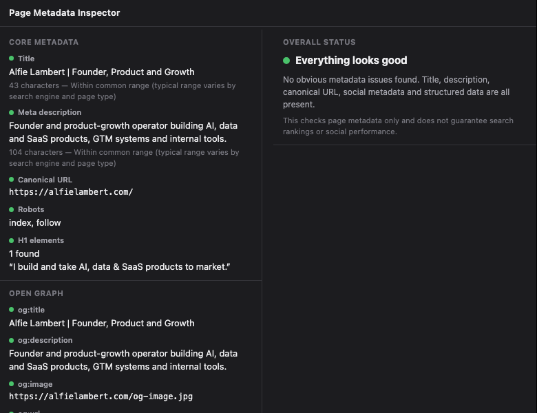

# Page Metadata Inspector

A focused, local-only Chrome extension for inspecting a page's SEO and social metadata in one click: title, meta description, canonical URL, robots directives, Open Graph, Twitter/X cards and JSON-LD structured data.

Built by [alfielambert.com](https://alfielambert.com).

  

## What it does

Click the toolbar icon while viewing any page and Page Metadata Inspector reads that page's `<head>` and body headings to answer:

- What is the page title, and is it a reasonable length?
- What is the meta description, and is it a reasonable length?
- What is the canonical URL?
- Are robots directives present, and what do they say?
- How many H1 elements are on the page?
- What Open Graph metadata exists (`og:title`, `og:description`, `og:image`, `og:url`, `og:type`)?
- What Twitter/X card metadata exists (`twitter:card`, `twitter:title`, `twitter:description`, `twitter:image`)?
- Is JSON-LD structured data present, how many blocks, and what `@type`s are declared?
- Are any obvious metadata fields missing?

It is a lightweight inspection tool, not a full SEO audit suite. It does not crawl, score, or validate against Schema.org.

## Features

- **One-click inspection** of the active tab. Nothing runs until you open the popup.
- **Core metadata**: title, meta description, canonical URL, robots content, H1 count (with restrained "Short / Long / Within common range" length hints, not hard ranking rules).
- **Open Graph** and **Twitter/X card** metadata display.
- **JSON-LD detection**: block count and detected `@type` values, with graceful handling of malformed JSON.
- **Severity-ranked issues** (Error / Warning / Info) with a plain-language explanation of why each one matters and a practical suggested fix, with a short HTML example where that helps.
- **Overall status summary** ("Everything looks good", "N issues found", "Needs attention") instead of a numeric SEO score.
- **Smart grouping**: related gaps are combined into one note instead of duplicate warnings. For example, a single "Twitter metadata not set" note when Open Graph already covers it, or one "missing social image" note when both `og:image` and `twitter:image` are absent.
- **Two-column layout** on wider popup sizes (metadata on the left, status and issues on the right), stacking on narrower widths.
- **Copy report**: copies a plain-text summary of status, issues and suggested fixes to your clipboard.
- **Graceful handling** of pages that can't be inspected (`chrome://` pages, the Chrome Web Store, etc.).
- **No backend, no login, no analytics, no external requests.** Everything runs inside the extension.

## Installation (local testing)

1. Download or clone this repository.
2. Open `chrome://extensions` in Chrome.
3. Enable **Developer mode** (top right).
4. Click **Load unpacked** and select the project folder (the one containing `manifest.json`).
5. Pin the extension from the puzzle-piece menu in the toolbar for quick access.
6. Visit any page and click the icon to inspect it.

## Permissions

Page Metadata Inspector requests the narrowest permission set that makes the feature work:

| Permission | Why it's needed |
|---|---|
| `activeTab` | Lets the extension read the page you're currently viewing, but only after you actively invoke it by clicking the toolbar icon. It grants no access to any other tab, and no access to this tab until you click. |
| `scripting` | Lets the extension run its metadata-extraction function in the active tab once you've invoked it via `activeTab`. This is what actually reads the title, meta tags, headings, and JSON-LD from the page. |

No `host_permissions` or `<all_urls>` are requested. The extension has no standing access to any site and cannot run in the background or on pages you haven't explicitly inspected.

## Privacy

All inspection happens locally in your browser. Page Metadata Inspector does not collect data, does not transmit browsing activity anywhere, includes no trackers or third-party scripts, and requires no account. See [PRIVACY.md](PRIVACY.md) for the full policy.

## Chrome Web Store

_Not yet published. Link will be added here once the listing is live._

## Links

- Homepage: [https://alfielambert.com](https://alfielambert.com)

## License

MIT. See [LICENSE](LICENSE).
